# EEMS — 엣지 AI 기반 가정 에너지 유연성 관리 시스템 기획서

> **[SmartHome-EdgeAI-EnergyManagement](https://github.com/dal-sj/SmartHome-EdgeAI-EnergyManagement) 리뉴얼 프로젝트** · 기획서 v1.0 · 2026-10-15
> 상태: **초안 (검토 대기)** · 이 문서의 그래프는 모두 **개념도·가설**이며 실험 결과가 아닙니다.
> 외부 사실은 2026-10-17에 원문으로 점검했습니다. 확인하지 못한 항목은 본문에 "미확인"으로 표시했습니다.

<p align="center">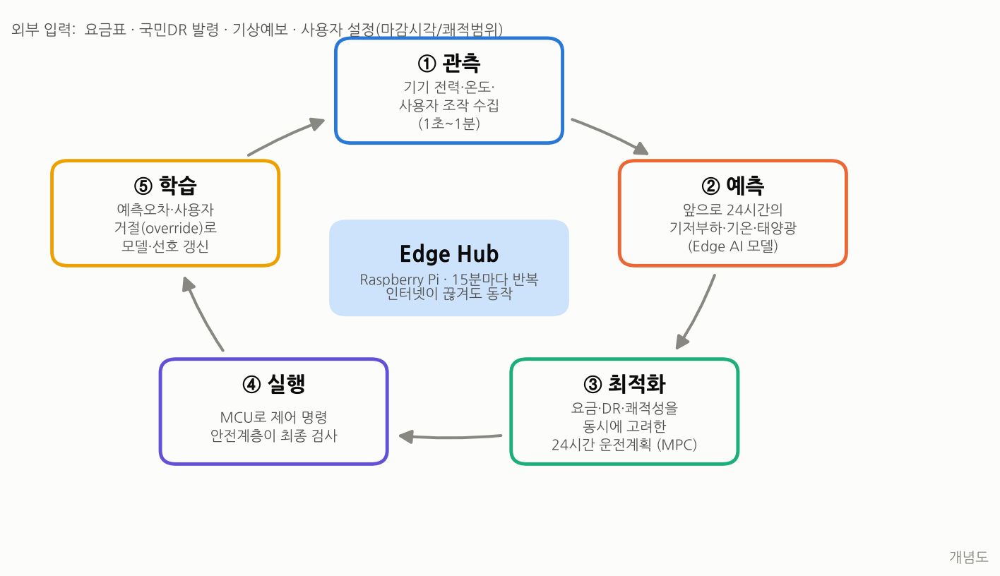</p>

---

## 📌 한 장 요약

| 구분 | 내용 |
|---|---|
| **성격** | **포트폴리오** 중심(**백엔드 + AI**). 연구 성과(근거 있는 실험 결과)는 보조 목표 |
| **전제** | 시간대에 따라 전기 가치가 달라지는 제도(국민DR·캐시백 시간대 보상)가 이미 있고, 주택용 시간대별 요금으로 확대 중(시점 미정). 근거는 1.3절 |
| **질문** | 집 안에 있는 작은 컴퓨터(Edge AI)가 스마트홈 에너지 관리를 **더 효율적**으로 만들 수 있는가? |
| **문제** | 전기는 "언제 쓰느냐"에 따라 가치가 다르다. 그런데 가정은 그 신호(요금·수요반응 요청)에 맞춰 움직이기 어렵다. 사람이 일일이 할 수 없고, 단순 타이머는 생활을 망친다. |
| **해결책** | 라즈베리파이 위의 AI가 **① 앞으로의 사용량·날씨를 예측**하고 **② 요금·DR·쾌적성을 함께 고려한 운전계획을 최적화(MPC)** 하며 **③ MCU로 기기를 제어**하고 **④ 사용자의 거절에서 선호를 학습**한다. 여러 집은 **Aggregator**가 협조시켜 "모두 같은 시간에 몰리는" 리바운드 피크를 막는다. |
| **Edge인 이유** | 인터넷이 끊겨도 동작 · 1초 단위 원시데이터는 집 밖으로 나가지 않음 · 30분 전 고지되는 DR에 지연 없이 반응 |
| **증명 방법** | 실데이터 기반 **디지털 트윈 시뮬레이션 → 라즈베리파이 HIL(Hardware-in-the-Loop) → 실물 축소 테스트베드** 3단계. 비교 기준 7종, 사전 정의한 KPI와 성공 기준, 통계 검정. |
| **데이터** | ENERTALK(한국 22가구, 가전 단위) · REFIT(영국 20가구, 2년) · Low Carbon London(5,567가구) · CityLearn v2(냉난방·PV·ESS) · KPX SMP/전력수요 · 기상청 ASOS · 국민DR 규칙 |
| **기술 스택** | MCU(기존) · Raspberry Pi(Python, MQTT, LightGBM/ONNX, HiGHS) · **Spring Boot 3 플랫폼**(Java 21, PostgreSQL+TimescaleDB) · React+TypeScript 웹 |
| **기간·인원** | 고정 기한 없음, 1\~2인. 단계마다 멈춰도 완성되는 프로토타입 우선 |

---

## 목차

1. [배경: 왜 이 프로젝트가 필요한가](#1-배경-왜-이-프로젝트가-필요한가)
2. [기존 프로젝트 회고: 무엇을 버리고 무엇을 남기나](#2-기존-프로젝트-회고-무엇을-버리고-무엇을-남기나)
3. [목표·연구 질문·성공 기준](#3-목표연구-질문성공-기준)
4. [핵심 아이디어: 제안 시스템](#4-핵심-아이디어-제안-시스템)
5. [시나리오](#5-시나리오)
6. [시스템 아키텍처](#6-시스템-아키텍처)
7. [데이터 계획](#7-데이터-계획)
8. [실험 설계와 증명 방법](#8-실험-설계와-증명-방법)
9. [하드웨어 테스트베드](#9-하드웨어-테스트베드)
10. [기술 스택과 Spring 사용 판단](#10-기술-스택과-spring-사용-판단)
11. [화면(UI) 기획](#11-화면ui-기획)
12. [일정·범위(프로토타입)](#12-일정범위프로토타입)
13. [리스크와 대응](#13-리스크와-대응)
14. [기대 효과와 한계](#14-기대-효과와-한계)
15. [다음 단계](#15-다음-단계)
16. [부록: 용어집 · 참고자료](#16-부록-용어집--참고자료)

---

## 1. 배경: 왜 이 프로젝트가 필요한가

### 1.1 전기는 '언제' 쓰느냐가 중요해졌다

- 태양광·풍력처럼 날씨에 따라 출력이 바뀌는 발전이 늘면서, 전력망은 **낮에는 남고 저녁에는 모자라는** 시간대별 불균형을 겪는다. 제주는 2021년 순부하(총부하 − 재생에너지)가 높은 저녁(16\~22시)을 최대부하 시간대로 옮겼고([메디게이트뉴스](https://medigatenews.com/stand/27292)), 정부는 2026년 요금 개편의 핵심을 "낮 시간대로 전력 소비를 유인하는 것"으로 밝혔다([정책브리핑](https://www.korea.kr/briefing/policyBriefingView.do?newsId=156755866)).
- 전력망 입장에서 가장 비싼 것은 "총사용량"보다 **"가장 많이 쓰는 순간(피크)"** 이다. 피크를 감당하려고 발전소·송전망을 추가로 지어야 하기 때문이다.
- 그래서 사용자가 **시간을 옮겨 쓰도록** 유도하는 장치가 생겼다: 시간대별 요금(TOU), 실시간 요금(RTP), **수요반응(DR)** 보상.

> 💡 **비유**: 전력망은 출퇴근 시간 도로와 같다. 차 대수(총사용량)보다 **출근길 정체(피크)** 가 문제다. 시간대를 조금만 분산해도 도로를 새로 놓지 않아도 된다.

### 1.2 이 문서에서 쓰는 핵심 용어 (처음 보는 사람용)

| 용어 | 한 줄 설명 | 비유 |
|---|---|---|
| **EMS / HEMS** | 에너지 사용을 측정·분석·제어하는 시스템. 가정용은 HEMS(Home EMS) | 집의 "에너지 집사" |
| **EMA** | EMS 안에서 실제 판단·명령을 내리는 에이전트(기존 프로젝트의 SEMA/CEMA) | 집사의 "두뇌" |
| **DR (수요반응)** | 전력망이 "지금 덜 써 주세요"라고 요청하면 줄이고 보상받는 제도 | 혼잡 시간 우회 시 받는 포인트 |
| **국민DR** | 가정·소형 점포(계약전력 200kW 이하)가 참여하는 한국 전력거래소(KPX)의 소규모 DR. 감축 시작 최소 30분 전 발령, 1시간 감축, 하루 2회 한도([전력시장운영규칙 제12.4.3.1조](https://marketrule.kpx.or.kr/lmxsrv/law/joHistoryContent.do?SEQ=2&SEQ_CONTENTS=5293&DATE_START=20210501&DATE_END=20231230), 2022-12 개정판) | — |
| **CBL (고객기준부하)** | "DR이 없었다면 얼마나 썼을까"의 추정치. 감축량 = CBL − 실제 사용량 | 다이어트 전 평소 체중 |
| **누진제 / TOU / RTP** | 많이 쓸수록 비싸짐 / 시간대별 고정 단가 / 시간마다 변하는 단가 | — |
| **유연 부하** | 시간을 옮기거나 세기를 조절할 수 있는 기기(세탁기, 에어컨, 온수기, 배터리, EV) | — |
| **Edge AI** | 클라우드가 아닌 **현장 기기(라즈베리파이)** 에서 돌아가는 AI | 본사 결재 없이 현장에서 판단 |
| **MPC (모델 예측 제어)** | 미래를 예측해 24시간 계획을 세우고, **첫 15분만 실행한 뒤** 새 정보로 다시 계획하는 방식 | 내비게이션의 "경로 재탐색" |
| **Aggregator** | 여러 가정을 묶어 전력망과 거래하고 서로 협조시키는 상위 관리자(기존 SEMA의 재해석) | 아파트 관리사무소 |

### 1.3 한국 가정의 현실과 이 프로젝트를 하는 이유

> ⚠️ **현행 주택용 요금은 누진제**(월 사용량 구간별 단가)라서, 사용 시간을 옮기는 것만으로는 **요금이 줄지 않는다.**

그런데도 이 프로젝트를 하는 이유는 **"시간대에 따라 전기의 가치가 달라지는 제도가 이미 있고, 늘어나는 중"** 이기 때문이다. 근거는 네 가지다. (모든 출처는 원문 확인, 2026-10 기준)

**① 정부가 소비 시간을 옮기려 한다**

| 내용 | 출처 |
|---|---|
| 2026-04-16 계절·시간대별 요금 개편 시행. "개편안의 핵심은 낮 시간대로 전력 소비를 유인하는 것" | [정책브리핑](https://www.korea.kr/briefing/policyBriefingView.do?newsId=156755866) |

**② 가정용 시간대별 보상은 지금도 있다**

| 제도 | 규모·조건 | 출처 |
|---|---|---|
| 국민DR | 발령 시간에 줄이면 kWh당 1,600원 수준 보상. 가정·편의점 등 약 1만 7천 개 자원 참여(2023-07) | [이투데이](https://www.etoday.co.kr/news/view/2265191) |
| 에너지캐시백 | 2025년 참여 166만 호, 절감 337GWh | [트윅24(한전)](https://www.twig24.com/news/local_gj/2026/03/04/20260304500086) |
| 에너지캐시백 여름 혜택 | 2026년 7\~8월 평일 17\~20시 절감분 1kWh당 500원 상당(AMI 가구) | [세계일보](https://www.segye.com/newsView/20260628505930) |
| 제주 계시별 요금 | 2021-09부터 누진제와 선택 가능 | [머니투데이](https://www.mt.co.kr/economy/2026/04/14/2026041415281687111) |

**③ 주택용 시간대별 요금은 확대 방향이다**

| 시점 | 내용 | 출처 |
|---|---|---|
| 2024-11 | 정부, 주택용 계절·시간대별 요금 단계적 도입 방침(보도) | [서울경제](https://www.sedaily.com/article/13984803) |
| 2026-04 | "주택용에 대해서도 시간대별 요금 적용을 확대해 나갈 계획" | [정책브리핑](https://www.korea.kr/briefing/policyBriefingView.do?newsId=156755866) |
| 2026-07 | 장관: "제주도부터 시작해 전국으로 확대해 나갈 계획" | [경북일보](https://www.kyongbuk.co.kr/news/articleView.html?idxno=4078239) |

**④ 수요는 이미 확인됐다**

| 사례 | 내용 | 출처 |
|---|---|---|
| 국내 가전사 | 삼성 SmartThings·LG ThinQ 앱으로 서울시 주민DR 가입 가능(2025) | [유스연합](https://www.youthassembly.kr/news/836564) |
| 영국 Octopus | Saving Sessions 가입 100만 명(2023-11), 전년 겨울 70만 고객에게 530만 파운드 지급 | [Octopus](https://octopus.energy/press/Saving-sessions-one-million/) |

**한계 (숨기지 않는다)**

| 한계 | 근거 |
|---|---|
| 주택용 시간대별 요금의 전국 시행 시점은 미정이다 | "전국 시행을 당장 계획하는 상황은 아님"([정책브리핑](https://www.korea.kr/briefing/policyBriefingView.do?newsId=156755866)). 2024년 "단계적 도입" 방침 이후 2026년에도 주택용은 제주뿐이다 |
| 시행의 걸림돌은 원격검침(AMI) 보급이다 | 장관 "AMI 보급이 충분치 않아 … 단계적으로 시행"([머니투데이](https://www.mt.co.kr/economy/2026/04/14/2026041415281687111)) |
| 캐시백 여름 혜택이 이어질지는 알 수 없다 | 2026년 한정으로 발표됨 |
| 지금 가정이 받는 금액은 크지 않다 | 누진제에서는 시간 이동만으로 요금이 줄지 않는다 |
| **선택형 요금제는 가입이 저조했다** | 제주 주택용 계시별 선택요금제(2021) 참여율 약 0.3%([한국경제, 2026-03-24](https://www.hankyung.com/article/202603243375i)). 선택제는 "기존 사용 패턴상 유리한 가구만 가입"할 수 있다는 지적([인사이트, 2026-07-15](https://www.insight.co.kr/news/563156)) |

> **전제**: 시스템은 제도를 설정으로 교체할 수 있게 만든다(4.6절). 평가는 **시간대별 요금(S2) + DR**을 기본 시나리오로, 현행 누진제(S1)를 비교 시나리오로 한다.

따라서 이 프로젝트의 "효율"은 하나가 아니라 **요금 체계별로 다르게** 정의해야 한다. 기존 프로젝트가 놓친 부분이다.

<p align="center">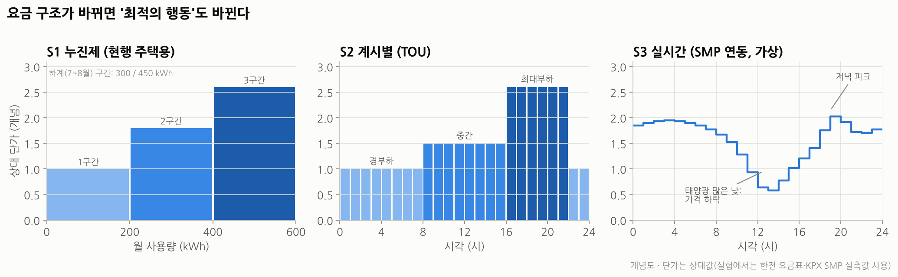</p>

| 요금 체계 | 가정이 얻는 이득 | 제안 시스템이 하는 일 |
|---|---|---|
| **S1 누진제 (현행, 비교용)** | 월 사용량 구간 관리 + 국민DR·캐시백 보상 | 월말 사용량 예측 → 상위 구간 진입 경고·회피, DR 이벤트 자동 대응 |
| **S2 계시별 TOU (기본 시나리오)** | 비싼 시간 → 싼 시간 이동 | 이동형 가전 재배치, 사전 냉방 |
| **S3 실시간 RTP (미래, SMP 연동 가상요금)** | 매시간 가격 차익 | 24시간 가격 예측 기반 최적 운전, ESS 충방전 |

---

## 2. 기존 프로젝트 회고: 무엇을 버리고 무엇을 남기나

| 항목 | 기존(2024 졸업프로젝트) | 문제점 | 개편 방향 |
|---|---|---|---|
| **문제 정의** | "에너지 49% 절감, 피크 100% 감소" | 기기를 **꺼서** 얻은 수치. 생활 불편이 비용으로 잡히지 않음. 에너지(kWh)·비용(원)·피크(kW)를 구분하지 않음 | 3가지 지표를 **분리**해 측정, **쾌적성·지연을 제약/비용으로** 포함 |
| **AI의 역할** | CEMA: 기기 ON/OFF **분류**(RF), SEMA: 지역 부하 예측(LSTM) | 분류 결과가 "무엇을 할지" 결정과 직접 연결되지 않음 | AI = **예측·NILM(모델링) + 모델 운영 MLOps(엔지니어링)**, 결정 = **최적화(MPC)**. 역할을 명확히 분리 |
| **데이터** | GREEND 일부 가구, 지역 부하를 1/n로 나눈 합성 가구 데이터 | 가구 수가 적고, 합성 데이터로 학습해 일반화 실패 | 한국·해외 공개 데이터 **다수 가구·장기간**, 라이선스 명시 |
| **평가** | 기준선 1개, 3가구, 단일 기간 | 비교 기준이 약하고 통계적 신뢰도 없음 | 비교 기준 7종, 다수 가구×1년 시뮬레이션, 신뢰구간·검정 |
| **Edge의 의미** | "라즈베리파이에서 돈다"에 그침 | Edge여서 **무엇이 좋은지** 측정하지 않음 | 지연·장애 내성·외부 전송량·자체 소비전력을 **Cloud와 A/B 비교** |
| **통신** | 연구실 레거시 EMAP(CoAP), OpenADR 2.0b XML | 유지보수 어려움, 문서화 부족 | MQTT(집 안) + **OpenADR 3.0 스타일 REST/JSON**(집 밖) |
| **UI** | Java Swing 데스크톱 GUI, 웹 UI 미완성 | 사용자가 결과를 볼 수 없음 | React 웹/모바일(PWA) + "왜 이렇게 했는지" 설명 |
| **재현성** | 이클립스 import 수동 설치 | 다른 사람이 실행하기 어려움 | Docker Compose, 데이터 다운로드 스크립트, CI |

**남기는 것**: Edge AI로 가정 에너지를 관리한다는 핵심 아이디어 · SEMA/CEMA 계층 구조의 직관(→ Aggregator/Edge Hub로 재해석) · 라즈베리파이/MCU 하드웨어.

---

## 3. 목표·연구 질문·성공 기준

### 3.1 최종 목표

> **"사용자의 생활을 해치지 않으면서, 가정의 전기요금·피크·DR 이행을 개선하는 Edge AI HEMS를 만들고, 그 효과와 Edge의 가치를 정량적으로 증명한다."**

### 3.2 연구 질문 (RQ)

| # | 연구 질문 | 증명 실험 |
|---|---|---|
| **RQ1** | 예측 기반 최적화(MPC)는 규칙 기반·반응형 DR보다 요금·피크를 얼마나 줄이는가? (쾌적성 유지 조건) | E2 |
| **RQ2** | 그 모든 것이 라즈베리파이에서 **실시간**으로 돌아가는가? Pi 자체 소비전력보다 절감량이 큰가? | E1, E4 |
| **RQ3** | Edge 배치는 Cloud 배치보다 **지연·장애 내성·프라이버시** 면에서 얼마나 나은가? | E4 |
| **RQ4** | AI 예측이 **얼마나 정확해야** 실제 절감으로 이어지는가? (예측 정확도의 가치) | E3 |
| **RQ5** | 여러 가정이 따로 최적화할 때 생기는 **리바운드 피크**를 Aggregator 협조로 막을 수 있는가? | E5 |

### 3.3 성공 기준 (실험 전에 미리 고정)

> 결과를 본 뒤 기준을 바꾸지 않도록 **사전 등록**한다. 미달 결과도 그대로 보고한다.

> **주 지표**는 **순비용(전기요금 − DR·캐시백 보상)의 규칙 기반(C1) 대비 개선율**, 보조 지표는 **오라클 대비 달성률**이다. 쾌적성·마감시각은 지켜야 할 조건이다. 아래 목표 수치는 v1.0에서 **근거 없이 정한 값**이며, C3에서 재검토한다.

| 지표 | 비교 대상 | 목표 |
|---|---|---|
| **순비용 (주 지표)** | 규칙 기반(C1) 대비 | 검토 중 |
| 전기요금 (S2·S3) | 무제어(C0) 대비 | **−10% 이상** |
| 피크 수요 (15분 평균 최대) | 무제어(C0) 대비 | **−20% 이상** |
| 국민DR 이행률 (CBL 대비 목표 감축 달성) | — | **90% 이상** |
| 오라클 대비 달성률 | 완벽 예측 MPC(C5) | **70% 이상** |
| 쾌적성 위반 | 설정 범위 이탈 | **가구당 하루 0.5 °C·h 이하** |
| 이동형 가전 마감 위반 | 사용자 마감시각 | **0건** (하드 제약) |
| 결정 지연 (예측+최적화) | Raspberry Pi 4 | **5초 이내** / 15분 주기 |
| 인터넷 단절 시 | 24시간 단절 | **제어 지속, 마감·쾌적 위반 없음** |
| 외부 전송량 | 원시데이터 스트리밍 대비 | **−95% 이상** |
| 순이익 | Pi 연간 소비전력(kWh)·비용 | 절감량 > Pi 자체 소비 |
| 리바운드 | 개별 최적화 대비 단지 피크 | **협조 시 피크 −15% 이상** |

---

## 4. 핵심 아이디어: 제안 시스템

### 4.1 한 문장 정의

> **EEMS**(Edge Energy Management System)는 집 안 라즈베리파이가 **예측(AI) → 최적화(MPC) → 안전 실행 → 학습**을 15분마다 반복하며 가정의 유연 부하를 운전하고, 단지 단위 Aggregator와는 **원시데이터 대신 "유연성"만** 주고받는 Edge AI HEMS다.

### 4.2 가정 내 자원 분류 — 무엇을 움직일 수 있나

| 분류 | 예시 | 조절 방식 | 사용자 제약 |
|---|---|---|---|
| **고정 부하** | 조명, TV, 조리, PC | 조절 안 함 (예측만) | — |
| **이동형 부하** | 세탁기, 식기세척기, 건조기 | **시작 시각**을 옮김 (한 번 시작하면 끝까지) | "내일 07시까지 끝내줘" (마감시각) |
| **열저장형 부하** | 에어컨, 난방, 전기온수기, 냉장고 | **세기/시점** 조절, 건물·물에 냉기·열을 저장 | 쾌적 온도 범위 (예: 24\~27 °C) |
| **전기저장형** | ESS 배터리, EV 충전 | 충전·방전 시점과 양 | 출발 시각까지 목표 충전량 |
| **발전** | 베란다·지붕 태양광 | 제어 안 함 (예측만) | — |

### 4.3 의사결정 엔진: 예측 + 최적화 + 안전계층

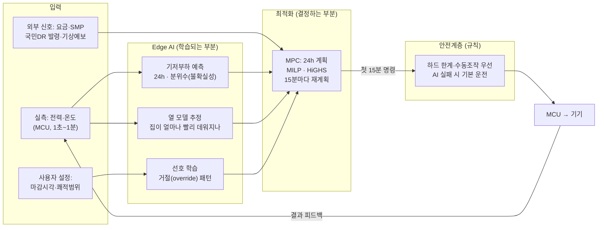

**최적화 문제(개념식)** — 15분 간격 24시간(96 스텝)을 한 번에 계획한다.

```math
\min_{u}\;\sum_{t=1}^{96}\Big[\underbrace{p_t\,P^{grid}_t\,\Delta t}_{\text{전기요금}} \;+\; \underbrace{\rho\,\big(T_t - \overline{T}\big)^{+} + \rho\,\big(\underline{T} - T_t\big)^{+}}_{\text{쾌적성 이탈 비용}}\Big] \;+\; \underbrace{\lambda \max_t P^{grid}_t}_{\text{피크 비용}} \;-\; \underbrace{r^{DR}\sum_{t\in\mathcal{E}}\big(CBL_t - P^{grid}_t\big)}_{\text{DR 보상}}
```

주요 제약:

- **전력 수지**: $`P^{grid}_t = \hat P^{base}_t + \sum_a P^{a}_t + P^{hvac}_t + P^{ch}_t - P^{dis}_t - \hat P^{pv}_t`$
- **열 모델(1R1C)**: $`T_{t+1} = T_t + \frac{\Delta t}{C}\Big(\frac{T^{out}_t - T_t}{R} - \eta P^{hvac}_t\Big)`$ — $`R, C`$는 Edge에서 **온라인 추정**
- **이동형 가전**: 사용자가 정한 [가능 시작, 마감] 안에서 정확히 한 번, 연속 운전 (이진 변수)
- **배터리**: 충전상태(SOC) 범위, 충·방전 효율, 출발 시 목표 충전량
- **계약전력**: $`P^{grid}_t \le P^{max}`$
- **요금 체계별 목적함수 교체**: S1은 $`p_t`$ 대신 "월 누진 구간 진입 페널티", S2·S3는 시간대별 $`p_t`$

> 💡 **왜 강화학습(RL)이 아니라 MPC가 주력인가?** MPC는 제약(마감시각·쾌적범위)을 **수학적으로 보장**하고, 결정 이유를 설명할 수 있으며, 학습 데이터가 적어도 동작한다. RL은 비교군(C6)으로 넣어 "더 복잡한 AI가 정말 더 나은가"를 검증한다.

### 4.4 사용자 중심 설계 — "꺼서 아끼는" 시스템이 아니다

| 원칙 | 구현 |
|---|---|
| **사용자가 규칙을 정한다** | 기기별 마감시각, 쾌적 온도 범위, DR 참여 여부, "오늘은 건드리지 마" 버튼 |
| **언제든 거절할 수 있다** | 수동 조작은 항상 최우선(안전계층). 거절은 실패가 아니라 **학습 데이터** |
| **이유를 설명한다** | "세탁기를 23시로 미뤘습니다 — 19시보다 약 OO원 저렴, 07시 전 완료 예정" |
| **불편을 숫자로 관리한다** | 지연시간·온도 이탈을 KPI로 측정하고 목적함수에 비용으로 포함 |

<p align="center">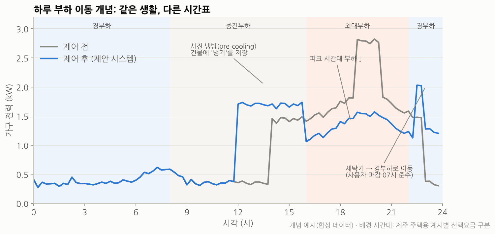</p>

### 4.5 커뮤니티 협조 — 기존 SEMA의 재해석

모든 집이 똑같이 "22시가 싸다"는 신호에 반응하면, 22시에 **새로운 피크(리바운드)** 가 생긴다. 이를 막기 위해 단지 단위 **Aggregator**가 각 가정의 **유연성 제안**(언제, 얼마나 줄이거나 늘릴 수 있는지)만 받아 배분한다.

<p align="center">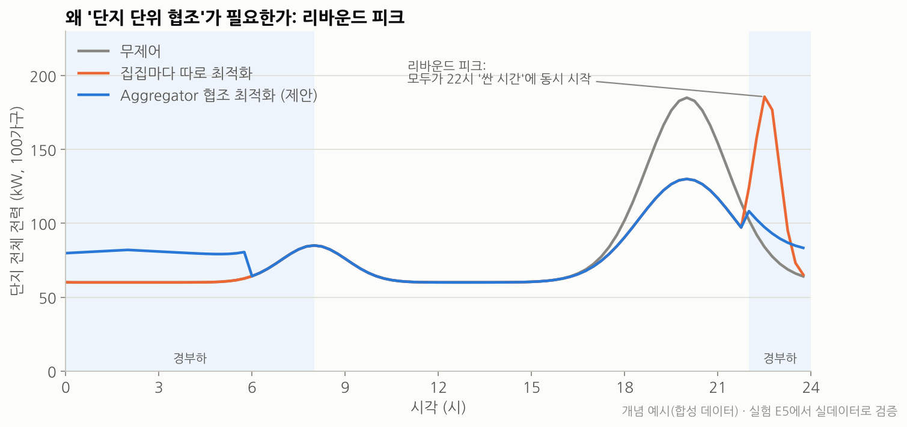</p>

| | 기존 SEMA/CEMA | 신규 Aggregator/Edge Hub |
|---|---|---|
| 상위가 받는 데이터 | 가정 사용량 | **유연성 제안 + 15분 집계값**만 |
| 상위가 내려주는 것 | 피크 시간 → 하위가 기기 OFF | 가정별 **목표 전력 상한/가격 신호** (분산 배분) |
| 결정 위치 | 상위 중심 | **각 가정이 최종 결정** (프라이버시·자율성) |

### 4.6 제도 추상화 — 규칙이 바뀌어도 코드는 그대로

**유사 상품 비교** (2026-10 조사, 각 사 공개 자료·보도 기준, 출처는 16장)

| 상품 | 하는 일 | 정산·기준선 담당 | 사용자 보상 |
|---|---|---|---|
| 삼성 SmartThings Energy | 매일 예측 사용량을 목표치와 비교(AI), 누진 구간 도달 전 가전을 "AI 절약모드"로 전환. 주민DR 시범사업 참여 | 한전·지자체·수요관리사업자 | 절약 미션 인센티브 |
| LG ThinQ · 한전 에너지케어앱 | 단지별 수요관리앱의 가입 창구 (AMI 설치 + 수요관리사업자가 있는 단지 우선) | 수요관리사업자 | 절약 미션 인센티브 |
| 한전 누진 3단계 알림 | 사용량이 3단계 기준(하계 450kWh, 기타계절 400kWh)의 80%에 도달하면 실시간 알림. 2026-07 한전ON 약 230만 호 시범, 12월 AMI 주택 1,100만 호로 확대 예정 | — | 없음(알림만) |
| 한전 주택용 에너지캐시백 | 기기 제어 없음, 월 절감량만 측정 | 한전. 기준선 = 직전 2개년 동월 평균 | 절감 kWh × 단가 |
| Octopus Saving Sessions (영국) | 1시간 절약 이벤트 | Octopus. 기준 = 평소 사용량 대비 | 포인트 → 요금 차감 |
| Google Nest Rush Hour Rewards (미국) | 피크 시 온도조절기를 최대 4°F 조정, 사전 냉방 | 전력회사 | 가입·유지 보상(전력회사별 상이) |

공통점: 제품은 **기기 제어·자동 참여**만 하고, 정산은 **프로그램 운영자**가 맡는다. EEMS도 정산 규칙을 직접 구현하지 않고, 제도를 세 요소로 추상화해 **설정만 교체**한다.

| 요소 | 국민DR | 주택용 에너지캐시백 |
|---|---|---|
| 이벤트 | 발령 시(30분 전 고지, 1시간) | 매월 |
| 기준선 | CBL(전력시장운영규칙 별표 28). 국민DR은 최근 평일 6일 중 Mid(4/6) 또는 10일 중 Mid(8/10) 적용 가능 | 직전 2개년 동월 평균 |
| 보상 | 감축 kWh × 단가 | 절감 kWh × 절감률 구간별 단가 |

- 결과는 실제 정산이 아닌 **정산 추정치**로 표기한다. 단가·기준은 구현 시점 공고로 갱신한다.
- **차별점**: 상용 제품도 사용량을 예측한다. 차이는 예측 결과로 **절약 모드를 일괄 전환**하느냐(C1), **시간대별 운전 계획**(사전 냉방·시간 이동)을 세우느냐(MPC)다. 이 차이의 효과를 같은 조건에서 비교해 증명한다.

---

## 5. 시나리오

| # | 시나리오 | 상황 | 시스템 동작 | 확인할 KPI |
|---|---|---|---|---|
| **S1** | 누진 구간 관리 | 여름, 월말 사용량이 2구간 경계 근처 | 월말 사용량 예측 → 남은 일수의 일일 예산 산정 → 에어컨 설정 최적화·알림 | 월 요금, 구간 초과 여부, 쾌적성 |
| **S2** | 국민DR 이벤트 | 18시 발령, 18:30\~19:30 감축 요청 | 30분 안에 사전 냉방·세탁 연기·ESS 방전 계획, CBL 대비 감축 | DR 이행률, 보상액, 쾌적성 |
| **S3** | 계시별 요금 | 제주형 TOU | 이동형 가전 경부하 배치, 최대부하 전 사전 냉방 | 요금, 피크 |
| **S4** | 실시간 요금 + PV + ESS | SMP 연동 가상 요금, 베란다 태양광 | 낮 잉여 태양광 저장 → 저녁 사용 | 요금, 자가소비율 |
| **S5** | 인터넷 단절 | 24시간 외부망 장애 | 마지막 수신 요금표·로컬 예측으로 계속 운전, 복구 후 동기화 | 제어 지속시간, 위반 건수 |
| **S6** | 단지 협조 | 100\~500가구, 동일 TOU | 개별 최적화 vs Aggregator 배분 비교 | 단지 피크, PAR, 공정성 |

**S2 국민DR 처리 흐름**

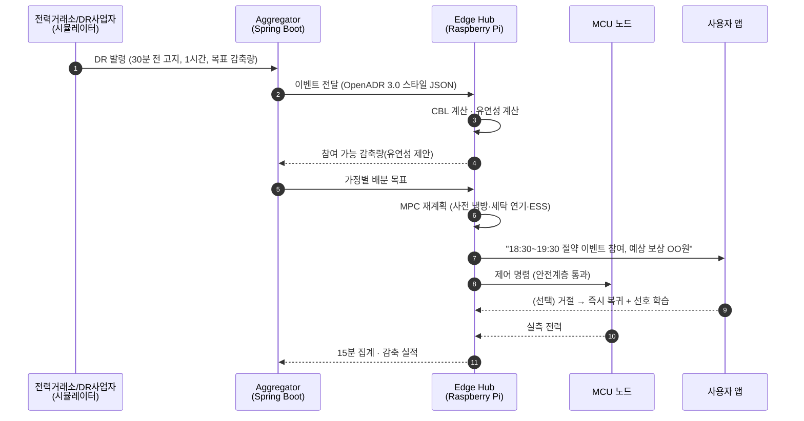

---

## 6. 시스템 아키텍처

### 6.1 전체 구성 (3계층)

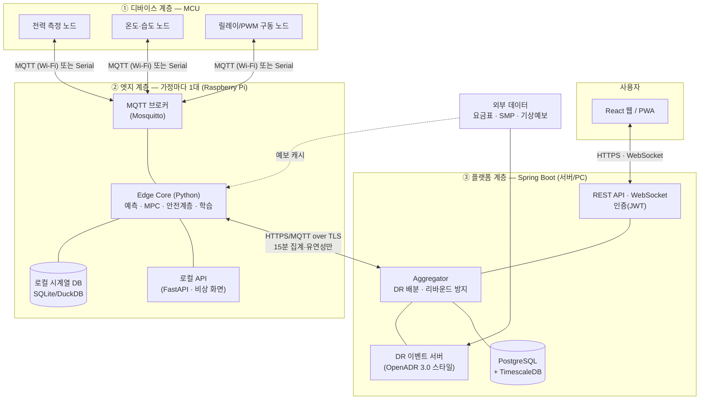

| 계층 | 장비 | 책임 | 인터넷 끊기면? |
|---|---|---|---|
| ① 디바이스 | MCU(기존 보유) | 측정·구동, 명령 미수신 시 **안전 기본값**으로 복귀 | 영향 없음 |
| ② 엣지 | Raspberry Pi | 예측·최적화·제어·학습, 원시데이터 보관 | **계속 동작** (마지막 요금표·로컬 예측) |
| ③ 플랫폼 | 서버/PC (Spring Boot) | 사용자·기기 관리, 대시보드, DR 배분, 장기 이력 | 엣지 단독 운전, 복구 후 동기화 |

### 6.2 데이터는 어디에 머무는가 (프라이버시 설계)

| 데이터 | 해상도 | 보관 위치 | 외부 전송 |
|---|---|---|---|
| 기기별 원시 전력 | 1초\~1분 | **Edge Hub (7\~30일 순환)** | ❌ (재실·생활패턴 노출 위험) |
| 실내 온도·사용자 조작 기록 | 1분 / 이벤트 | Edge Hub | ❌ |
| 가구 집계 전력 | 15분 | Edge Hub + 플랫폼 | ✅ (대시보드·CBL 정산용) |
| 유연성 제안 / DR 실적 | 이벤트 | 플랫폼 | ✅ |
| 학습된 모델 가중치 | — | Edge Hub | (확장) 연합학습 시 가중치만 |

### 6.3 통신 인터페이스

**집 안 — MQTT 토픽 규약**

| 토픽 | 방향 | 예시 페이로드 |
|---|---|---|
| `home/{hid}/dev/{did}/telemetry` | MCU → Hub | `{"ts":1739..., "p_w":812.4, "t_c":25.1}` |
| `home/{hid}/dev/{did}/cmd` | Hub → MCU | `{"mode":"on","level":0.6,"ttl_s":900}` ← `ttl` 지나면 MCU가 기본값 복귀 |
| `home/{hid}/dev/{did}/state` | MCU → Hub (retain) | `{"online":true,"fw":"1.2.0"}` |

**집 밖 — REST/JSON (OpenADR 3.0 개념 차용)**: `POST /events`(DR 발령), `GET /programs`, `POST /reports`(15분 집계·실적), `POST /flex-offers`(유연성 제안). 계약은 **OpenAPI 명세 먼저** 작성 → Spring과 Python이 같은 명세로 개발.

---

## 7. 데이터 계획

> 기존 프로젝트 데이터는 모두 폐기한다고 가정하고, **필요한 데이터 → 후보 → 선정** 순으로 정했다.

### 7.1 필요한 데이터

| 필요 | 이유 |
|---|---|
| 가전 단위 전력 (가능하면 한국) | 이동형·열저장형 부하의 실제 사용 패턴 추출, 예측 학습 |
| 장기간(1년 이상) | 계절 변화, 시간 순서 분할(학습/검증/테스트) |
| 다가구(100가구 이상) | 커뮤니티·리바운드 실험, 통계적 신뢰도 |
| 냉난방·PV·ESS 모델 | 가장 큰 유연 자원을 물리적으로 시뮬레이션 |
| 가격·DR 신호 (한국) | 요금 시나리오 S1\~S4, 국민DR 이벤트 |
| 기상 (한국) | 냉방 부하·태양광 발전 예측 입력 |

### 7.2 선정 데이터셋

<p align="center">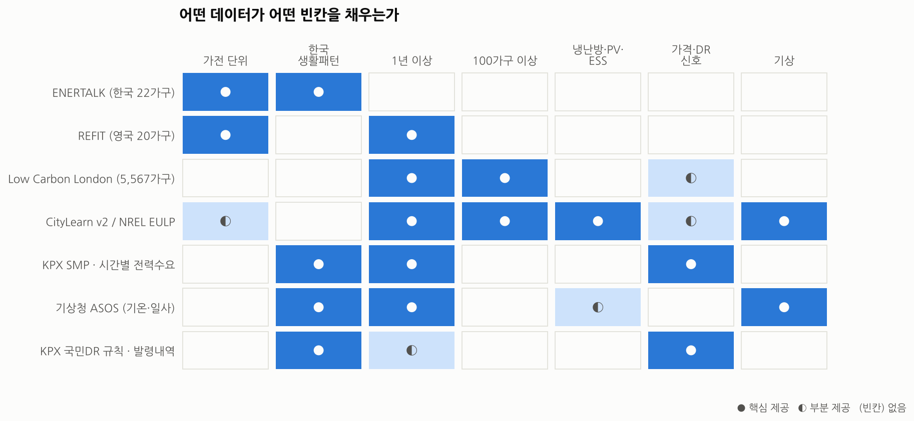</p>

| 데이터셋 | 규모·해상도 | 라이선스 | 이 프로젝트에서의 역할 |
|---|---|---|---|
| **ENERTALK** (Shin et al., 2019) | 한국 22가구, 가구별 29\~122일, **15Hz**, 전체+가전(냉장고·김치냉장고·밥솥·세탁기·TV·전자레인지·정수기) | 논문 CC BY 4.0, 데이터 파일 조건은 figshare에서 확인 필요 | **한국 생활패턴** 검증, 세탁기 작업 이벤트 추출, 냉장고 열저장 특성 |
| **REFIT** (Murray et al., 2017) | 영국 20가구, **2년**, 8초, 전체+가전 9종 | **CC BY 4.0** | 장기 예측 모델 학습, 세탁기·식기세척기·건조기 이동형 부하 라이브러리 |
| **Low Carbon London** (UKPN) | 런던 **5,567가구**, 30분, 2011\~2014, 약 1,100가구 **동적 TOU 실험** 포함 | CC BY 계열(London Datastore에서 최종 확인) | 커뮤니티 규모 실험(E5), 실제 TOU 가격 반응 참고, 연합학습 확장 |
| **CityLearn v2** + NREL EULP | 미국 건물 스톡(End-Use Load Profiles) 기반 가상 단지. 히트펌프·배터리·전기차 제어(초록 기준, 온수·PV 세부는 미확인) | 오픈소스 | 열저장·ESS 시뮬레이션, **공개 벤치마크 환경**(규칙 기반·MPC·RL 비교) |
| **KPX 시간별 SMP** (공공데이터포털) | 파일: 육지 일별 시간별. OpenAPI: 육지·제주(향후 삭제 예정 공지) | 이용허락 제한 없음 | S3 실시간 가상요금, 가격 예측 |
| **KPX 시간별 전국 전력수요** | 시간별 MWh | 이용허락 제한 없음 | 전력망 피크일 추정 → DR 발령 시나리오 생성 |
| **기상청 ASOS** | 시간별 기온·습도·일사 | 공공데이터 | 냉방 열모델 외기온도, pvlib 태양광 발전 추정 |
| **국민DR 규칙·발령내역** | 규칙: 30분 전 발령·1시간·일 2회(제12.4.3.1조), CBL(별표 28). 발령내역 API: 발령일시·시작·감축·종료 시간 | 발령내역 API 이용허락 제한 없음 | DR 이벤트 생성, CBL 계산기 구현 |
| **한전 요금표** | 누진 구간: 하계 300/450kWh, 기타계절 3단계 400kWh(2단계 200kWh 경계는 한전 원문 접속 불가로 미확인). 제주 계시별: 경부하 22\~8시, 중간 8\~16시, 최대 16\~22시(2021 개편) | 공개 | S1·S2 요금 계산 (단가는 구현 시점 요금표를 설정 파일로) |

**제외한 후보와 이유**

| 후보 | 제외 이유 |
|---|---|
| Pecan Street Dataport | 품질은 최고지만 이용 계약·재배포 제한 → 오픈 저장소 프로젝트에 부적합 |
| UK-DALE | 5가구로 적음 (REFIT과 역할 중복) |
| GREEND (기존 사용) | 가구 수·기간 부족, 기존 실험 재사용 방지 |
| 상용 스마트플러그 클라우드 데이터 | 수집 기간이 너무 짧고 1가구 |

> ⚠️ **데이터 이질성 대응**: 해외 데이터의 **부하 형태**를 쓰더라도 **가격·DR·기상 신호는 한국 기준으로 통일**한다. 한국 데이터(ENERTALK)로 학습/검증한 결과와 해외 데이터 결과를 **나란히 보고**해 일반화 가능성을 검증한다. 원본 데이터는 저장소에 올리지 않고 **다운로드 스크립트만** 커밋한다.

### 7.3 데이터 파이프라인과 디지털 트윈

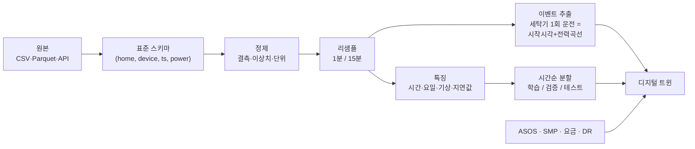

**디지털 트윈(가상 가정)의 구성**

| 구성요소 | 만드는 방법 |
|---|---|
| 기저부하 | 실데이터를 그대로 재생 (조절 불가 부분) |
| 이동형 가전 | 실데이터에서 추출한 **운전 이벤트**(원래 시작시각·전력곡선)를 "작업 요청"으로 변환 → 제어기가 시작시각 결정 |
| 냉방/난방 | 1R1C 열모델 + 서울 ASOS 외기온도 (파라미터는 CityLearn·문헌 범위에서 샘플링) |
| 태양광 | pvlib + ASOS 일사량, 용량 0.4\~3kW 시나리오 |
| ESS | 용량·효율·SOC 모델 |
| 신호 | 한전 요금표, KPX SMP, 국민DR 규칙 기반 이벤트 생성기 |
| 사용자 | **합성 사용자 모델**: 지연·온도 이탈이 클수록 거절 확률 증가 (선호 학습 검증용) |

**누수 방지 원칙**: 시간 순서 분할만 사용(랜덤 분할 금지), 테스트 기간 데이터로 하이퍼파라미터 조정 금지, 예측 입력에는 "그 시점에 알 수 있었던 정보"만 사용(실측 기온 대신 예보값 또는 노이즈 추가).

---

## 8. 실험 설계와 증명 방법

### 8.1 3단계 검증

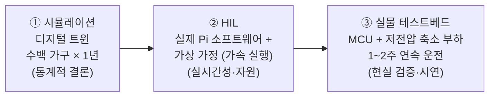

| 단계 | 질문 | 왜 필요한가 |
|---|---|---|
| ① 시뮬레이션 | 알고리즘이 **효과가 있는가?** | 많은 가구·긴 기간으로 통계적 결론. 실물로는 불가능 |
| ② HIL | **라즈베리파이에서** 같은 결과가 나오는가? | 연산 지연·메모리·네트워크 장애를 실제 장비로 측정 |
| ③ 실물 | **현실의 잡음** 속에서도 동작하는가? | 센서 오차, 구동 지연, 열모델 오차(sim-to-real gap) 측정 |

### 8.2 비교 대상 (Controllers)

| ID | 제어기 | 설명 | 의미 |
|---|---|---|---|
| **C0** | 무제어 | 데이터 그대로 | 기준선 |
| **C1** | 규칙 기반 | 예측 사용량이 목표를 넘으면 절약 모드 일괄 전환, "경부하에만 세탁기", "고정 설정온도" | 상용 스마트홈 앱 방식(공개 설명 기반 추정). **주 비교 대상** |
| **C2** | 반응형 DR | DR 발령 시 지정 기기 OFF (기존 프로젝트 방식) | 기존 방식과의 비교 |
| **C3** | MPC + 단순 예측 | 예측 = 어제 같은 시각 | AI 예측의 기여 분리 |
| **C4** | **MPC + Edge AI 예측 (제안)** | LightGBM/소형 신경망 예측 + 선호 학습 | 본 프로젝트 |
| **C5** | MPC + 완벽 예측 (오라클) | 미래를 정확히 안다고 가정 | **이론적 상한** |
| **C6** | 강화학습 (SAC 등) | CityLearn에서 학습 | "더 복잡한 AI"와의 비교 |

> **오라클 대비 달성률** = (C0 − C4) / (C0 − C5). "가능한 최대 개선 중 몇 %를 얻었는가"를 보여주므로 데이터 난이도와 무관하게 공정하다.

### 8.3 KPI 정의

| 범주 | KPI | 정의 |
|---|---|---|
| 비용 | 전기요금(원/월) | 시나리오별 요금표로 계산 |
| 전력망 | 피크(kW) · PAR | 15분 평균 최대 / 피크÷평균 |
| 전력망 | DR 이행률 | (CBL − 실측) ÷ 목표 감축량, 이벤트 시간 평균 |
| 에너지 | 총사용량(kWh) | **별도 보고** — 시간 이동은 kWh를 줄이지 않을 수 있음을 명시 |
| 사용자 | 쾌적성 위반(°C·h) | 설정 범위 밖 온도 × 시간 |
| 사용자 | 평균 지연(h) · 마감 위반 · 거절 횟수 | 이동형 가전 기준 |
| Edge | 결정 지연(ms) · CPU · RAM · Pi 소비전력(W) | HIL에서 측정 |
| Edge | 외부 전송량(MB/일) · 단절 시 제어 지속 | Edge vs Cloud 비교 |
| 커뮤니티 | 단지 피크 · PAR · 부담 공정성(Jain 지수) | E5 |

### 8.4 실험 목록

| 실험 | RQ | 내용 | 변수 | 산출물 |
|---|---|---|---|---|
| **E1 예측** | RQ2 | 기저부하·PV 24h 예측 모델 비교 | 단순예측 / SARIMA / LightGBM / 소형 TCN·LSTM(ONNX, 양자화) | 정확도(nMAE, 분위수 손실) vs **Pi 추론시간·메모리** 표 |
| **E2 제어 (핵심)** | RQ1 | C0\~C6 × S1\~S4 × 다수 가구 × 1년 | 제어기, 요금 체계, 자원 구성(PV/ESS 유무) | KPI 표, 가구별 분포, 신뢰구간 |
| **E3 예측의 가치** | RQ4 | 예측 오차를 인위적으로 0\~40% 변화 | 예측 오차, 예측 모델 | "오차 vs 달성률" 곡선 (아래 그래프를 실측으로 교체) |
| **E4 Edge vs Cloud** | RQ2·3 | 같은 제어기를 Pi / 원격 서버에 배치, `tc netem`으로 지연·손실·단절 주입 | 지연 50\~500ms, 손실, 1\~24h 단절 | 지연·위반·전송량·소비전력 비교 |
| **E5 커뮤니티** | RQ5 | Low Carbon London 100\~500가구 | 개별 최적화 vs 협조, 가구 수 | 단지 피크·PAR·공정성 |
| **E6 실물** | 전체 | 테스트베드 1\~2주 연속 운전 | — | sim-to-real 오차, 구동 지연, 시연 영상 |

<p align="center">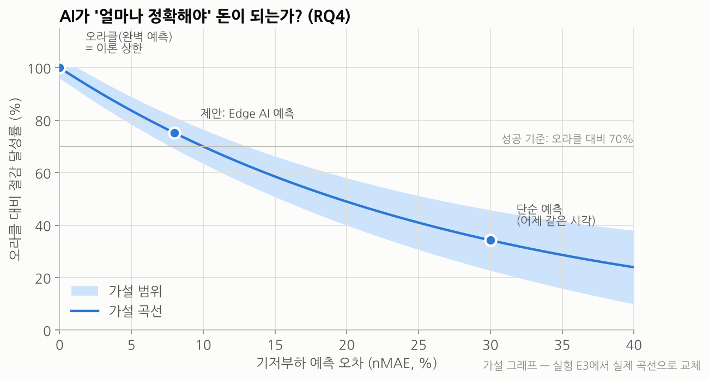</p>

### 8.5 통계적 검증

- **단위**: 가구-일(house-day). 같은 가구-일에 모든 제어기를 적용하는 **대응 비교**(paired).
- **보고**: 평균 ± **95% 부트스트랩 신뢰구간**, 가구별 분포(박스플롯). 평균만 보고하지 않는다.
- **검정**: Wilcoxon 부호순위 검정(C4 vs C1/C2/C3), 다중비교 보정(Holm).
- **재현성**: 난수 시드 고정, RL은 시드 5개 이상, 실험 설정·결과는 MLflow로 기록.
- **절제 실험(Ablation)**: 선호 학습 제거 / 열모델 온라인 추정 제거 / 분위수 예측 → 점 예측 / MPC 주기 15→60분.

---

## 9. 하드웨어 테스트베드

> 안전을 위해 **220V 가전을 직접 제어하지 않고**, 저전압(5\~12V DC) 축소 부하로 같은 동작을 재현한다. 실가전은 정격 인증된 스마트플러그로 **측정만** 하는 것을 선택 사항으로 둔다.

| 실제 기기 | 축소 모형 | 측정/구동 |
|---|---|---|
| 에어컨(열저장형) | **단열 상자 + 12V 히터 패드/펠티어 + 팬** | 온도센서(SHT31/DHT22), PWM 구동 → 실제 열 동역학으로 MPC 검증 |
| 세탁기(이동형) | LED/저항 부하 + 미리 정한 전력 곡선 재생 | 릴레이/MOSFET |
| ESS | 소형 리튬 배터리 + 충전 모듈 (또는 가상 배터리) | 전압·전류(INA219) |
| 기저부하 | 프로그래머블 부하 또는 데이터 재생(가상) | — |
| Edge Hub | **Raspberry Pi (기존)** | USB 전력계로 **Pi 소비전력 측정** |
| MCU 노드 | **기존 MCU** (Wi-Fi 가능 시 MQTT, 아니면 Pi와 USB-Serial) | 명령 TTL 만료 시 안전 기본값 |

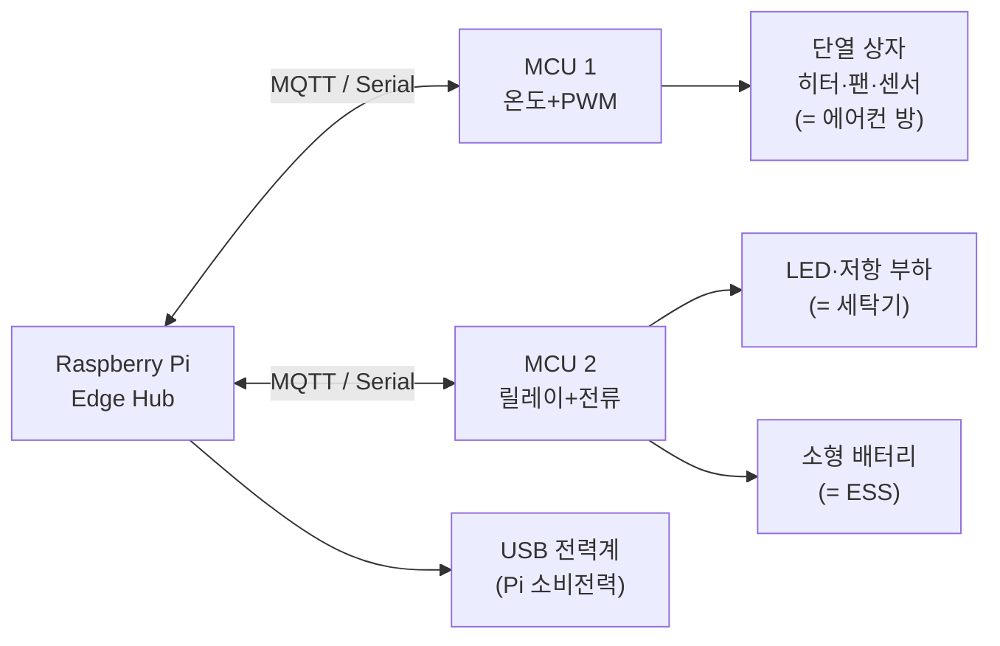

---

## 10. 기술 스택과 Spring 사용 판단

### 10.1 계층별 기술 스택

| 계층 | 기술 | 선택 이유 |
|---|---|---|
| **MCU 펌웨어** | C++ (Arduino/PlatformIO), MQTT 클라이언트(Wi-Fi MCU) 또는 Serial | 기존 MCU 그대로 사용, 단순·저전력 |
| **Edge Hub** | Raspberry Pi OS 64-bit, **Python 3.12**, Mosquitto(MQTT), FastAPI(로컬 API), SQLite/DuckDB | 가볍고, AI·최적화 생태계가 Python에 집중 |
| **Edge AI** | LightGBM, PyTorch → **ONNX Runtime**(추론), scikit-learn, 온라인 RLS(열모델) | Pi 추론 시간은 E1에서 측정(목표: 수십 ms 이내) |
| **최적화** | **HiGHS**(오픈소스 MILP 솔버) + linopy/Pyomo | MIT 라이선스, Windows·Linux·macOS 지원(Pi ARM 동작은 E1에서 확인), 96스텝 문제는 수 초 이내 목표 |
| **플랫폼 서버** | **Java 21, Spring Boot 3.x** (Web, Data JPA, Security+JWT, Validation, WebSocket/STOMP, Scheduling), Spring Integration MQTT, Flyway, springdoc-openapi | 정형화된 서버 업무(인증·CRUD·이벤트·실시간 푸시)에 최적 |
| **데이터베이스** | **PostgreSQL 16 + TimescaleDB** | 일반 데이터와 시계열을 한 DB에서, SQL 그대로 |
| **프론트엔드** | **React 18 + TypeScript + Vite**, TanStack Query, Apache ECharts, Tailwind, PWA | 대시보드·차트에 강함, 모바일 설치 가능 |
| **연구/시뮬레이션** | pandas/Polars, CityLearn, pvlib, Optuna, **MLflow**, Jupyter | 실험 추적·재현성 |
| **인프라** | Docker Compose, GitHub Actions(CI), Testcontainers, `tc netem`(네트워크 장애 주입) | 한 줄 실행, 자동 테스트 |
| **(확장)** | Flower(연합학습), Grafana(모니터링), Matter 연동 | 선택 |

### 10.2 Spring을 쓸 것인가? → **"플랫폼 계층에 한정해 사용" 권장**

| 선택지 | 장점 | 단점 | 판단 |
|---|---|---|---|
| A. 전부 Python (FastAPI) | 언어 하나, 빠른 개발 | 서버 구조·보안·대규모 설계 학습 기회 적음, 포트폴리오상 백엔드 역량 증명 약함 | 차선 |
| **B. Spring 플랫폼 + Python 엣지** | 각 계층에 맞는 도구, Spring 학습 범위가 **정형화된 영역**에 한정, 국내 백엔드에서 많이 쓰는 스택(판단, 통계 미확인) | 언어 2개, 인터페이스 관리 필요 | ✅ **권장** |
| C. 전부 Java | 언어 하나 | Pi에서 JVM 메모리 부담, ML·최적화 생태계 빈약 → 연구 속도 저하 | 비권장 |

**권장 이유**

1. Spring이 맡는 일(로그인, 기기·사용자 CRUD, MQTT/REST 수신, WebSocket 푸시, DR 이벤트 스케줄링)은 **교과서적 패턴**이라 Spring을 처음 제대로 익히기에 적당한 난이도다.
2. AI·최적화는 Spring에 **의존하지 않도록** 경계를 나눈다(OpenAPI 계약 + MQTT). Spring이 늦어져도 **연구(P1\~P4)는 멈추지 않는다.**
3. 라즈베리파이에는 JVM을 올리지 않아 엣지 자원을 아낀다.

### 10.3 저장소 구조(제안)

```text
EEMS/
├── firmware/        # MCU (PlatformIO)
├── edge-hub/        # Raspberry Pi: Python (예측·MPC·안전계층·MQTT·로컬 API)
├── platform/        # Spring Boot 3 (Aggregator·API·DR 이벤트)
├── web/             # React + TypeScript
├── research/        # 데이터 파이프라인·디지털 트윈·실험(E1~E6)·노트북
├── contracts/       # OpenAPI 명세, MQTT 토픽·스키마 (계층 간 약속)
├── deploy/          # docker-compose, 설정
└── docs/            # 기획서·설계서·실험 보고서
```

---

## 11. 화면(UI) 기획

| 화면 | 핵심 내용 | 사용자 질문 |
|---|---|---|
| **홈** | 현재 전력, 오늘 예상 요금, 이번 달 누진 구간 진행률, 진행 중 DR 이벤트 | "지금 괜찮아?" |
| **오늘의 계획** | 24시간 타임라인: 기기별 예정 운전 블록 + 요금 시간대 배경 + **"왜?" 설명** | "왜 세탁기가 안 돌아?" |
| **기기** | 기기별 상태·사용량, 마감시각·쾌적범위 설정, "오늘은 건드리지 마" | "이건 내가 정할래" |
| **이벤트** | 국민DR 발령·참여 결과, CBL 대비 감축량·보상 | "얼마 벌었어?" |
| **리포트** | 주/월별 요금·피크·쾌적성, 무제어 대비 추정 절감 | "효과 있어?" |
| **관리자(단지)** | 가구 수, 단지 부하·피크, 이벤트 배분 현황 | "단지 피크 괜찮아?" |

**"오늘의 계획" 화면 예시**

| 시각 | 00–08 | 08–12 | 12–16 | 16–22 | 22–24 |
|---|---|---|---|---|---|
| 요금 시간대 | 경부하 | 중간 | 중간 | **최대부하** | 경부하 |
| 에어컨 | 꺼짐 | 꺼짐 | **사전 냉방** | 약하게 유지 | 꺼짐 |
| 세탁기 | — | — | — | — | **23:00 시작** |
| ESS | 충전 | — | — | **방전** | — |

> 💬 세탁기를 19시 → 23시로 옮겼어요. 07시 전 완료 예정입니다. **[되돌리기]**

---

## 12. 일정·범위(프로토타입)

<p align="center">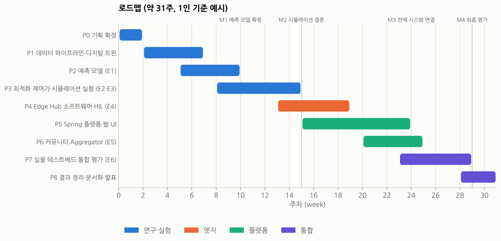</p>

| 마일스톤 | 시점 | 완료 조건 |
|---|---|---|
| **M1** 예측 모델 확정 | 10주 | E1 표 완성, Pi 추론시간 측정 |
| **M2** 시뮬레이션 결론 | 15주 | E2·E3 결과로 RQ1·RQ4 답변 (여기까지가 연구의 핵심) |
| **M3** 전체 시스템 연결 | 24주 | MCU → Pi → Spring → 웹까지 데이터·명령 왕복 |
| **M4** 최종 평가 | 29주 | E4\~E6 완료, 최종 보고서 |

**범위 구분** — 시간이 부족하면 아래부터 자른다.

| 필수 (프로토타입) | 선택 (확장) |
|---|---|
| 디지털 트윈 + E1\~E4 | E5 커뮤니티 Aggregator |
| Edge Hub (예측·MPC·안전계층·MQTT) | C6 강화학습 비교 |
| Spring 플랫폼 최소 기능 (인증·기기·이력·DR 이벤트·WebSocket) | 연합학습(Flower) |
| MLOps: Spring이 모델 버전·Edge 배포·성능 감시·재학습 관리 | |
| 웹: 홈·오늘의 계획·기기 설정 | |
| **2단계**: Edge NILM (분전반 센서 1개로 기기 추정, ENERTALK) | |
| 테스트베드: 단열 상자 + 1개 이동형 부하 | Matter 기기 연동, 탄소 배출 최적화 |

---

## 13. 리스크와 대응

| 리스크 | 영향 | 대응 |
|---|---|---|
| 한국 가전 데이터 부족 (ENERTALK는 냉난방 없음, 최대 122일) | 일반화 의문 | 해외 데이터로 보강 + 신호는 한국 기준 통일 + 한국/해외 결과 병기 |
| 실가전 직접 제어 불가 (안전·제조사 API) | 현실성 | 저전압 축소 모형 + 시뮬레이션, 실가전은 측정만 |
| Pi에서 MILP 계산 지연 | 실시간성 | 수평선·해상도 축소, warm-start, 휴리스틱 대체안 준비 |
| 실제 사용자 선호 데이터 없음 | 선호 학습 검증 | 합성 사용자 모델로 검증 + 본인 실사용 소규모 기록 |
| Spring 학습 곡선 | 일정 지연 | 범위 최소화, OpenAPI 계약 우선, 엣지 독립 동작 설계 |
| 범위 과다 (기한 없음) | 미완성 | 프로토타입 우선, M2에서 범위 재조정 |
| 결과 과장 (기존 프로젝트의 교훈) | 신뢰도 | 성공 기준 사전 등록, 오라클 상한 함께 보고, 음의 결과도 보고 |
| 데이터 라이선스 | 법적 문제 | 원본 미커밋, 다운로드 스크립트 + 출처·라이선스 명시 |
| 국민DR 세부 규칙 변경 | 시나리오 정확도 | CBL 산정 방식을 설정값으로 분리, 구현 시점 규칙으로 갱신 |

---

## 14. 기대 효과와 한계

**기대 효과**

- 🏠 **가정**: 생활을 해치지 않는 범위에서 요금·DR 보상 개선, "왜 그렇게 했는지" 이해 가능한 자동화
- ⚡ **전력망**: 피크 완화, DR 자원 확보, 리바운드 없는 단지 단위 유연성
- 🔒 **프라이버시**: 생활패턴이 드러나는 원시데이터를 집 밖으로 보내지 않는 구조
- 🎓 **개인 역량**: 시계열 예측·최적화·임베디드·Spring 백엔드·프론트엔드를 하나의 **근거 있는 결과물**로 증명

**정직한 한계**

- 현행 누진제에서는 **시간 이동만으로 요금이 줄지 않는다** — S1의 효과는 주로 구간 관리와 DR 보상에서 나온다.
- 기본 시나리오(S2)의 주택용 시간대별 요금은 2026년 기준 정부가 **확대 계획**을 밝힌 단계이며, 전국 시행은 당장 계획되어 있지 않다(1.3절). 시점과 단가는 정해지지 않았다.
- 시간 이동은 **에너지(kWh) 자체를 줄이지 않을 수 있다.** 이 프로젝트의 핵심 성과는 kWh보다 **비용·피크·DR 이행**이다.
- 시뮬레이션 결과는 모델 가정에 의존한다 → HIL·실물 단계로 오차를 측정해 함께 보고한다.

---

## 15. 다음 단계

이 기획서 승인 후 바로 할 일:

- [ ] 기획서 검토·피드백 반영 (특히 성공 기준 수치, 범위)
- [ ] 보유 하드웨어 목록 확정 (Pi 모델, MCU 종류·개수, 센서) → 9장 테스트베드 구체화
- [ ] 저장소 골격 생성 (기존 코드는 [이전 레포](https://github.com/dal-sj/SmartHome-EdgeAI-EnergyManagement)에서 참고만)
- [ ] `contracts/` 초안: MQTT 토픽·페이로드 스키마, OpenAPI 최소 명세
- [ ] 데이터 다운로드 스크립트 (REFIT, ENERTALK, KPX SMP, ASOS) + 라이선스 재확인
- [ ] 다음 문서: **시스템 설계서**(모듈·클래스·DB 스키마) · **실험 계획서**(E1\~E6 상세 프로토콜)

---

## 16. 부록: 용어집 · 참고자료

### 용어집 (추가)

| 용어 | 설명 |
|---|---|
| PAR (Peak-to-Average Ratio) | 피크 ÷ 평균. 낮을수록 부하가 고르게 분산 |
| MILP | 정수 변수(켜짐/꺼짐, 시작 시각)를 포함한 선형 최적화 |
| HIL (Hardware-in-the-Loop) | 실제 하드웨어에서 소프트웨어를 돌리고, 환경은 시뮬레이터로 대체하는 시험 |
| 분위수 예측 | "평균 2kW"가 아니라 "90% 확률로 3kW 이하"처럼 불확실성까지 예측 |
| 1R1C 열모델 | 집을 저항(단열) 1개 + 축열 용량 1개로 단순화한 온도 변화 모델 |
| 리바운드 피크 | 여러 가정이 같은 저가 시간대로 몰려 새로 생기는 피크 |
| 연합학습 | 데이터는 각 집에 두고 모델 가중치만 모아 함께 학습하는 방법 |
| NILM | 분전반 전체 전력 하나로 개별 기기 사용을 추정하는 기술 |

### 참고자료

**데이터**
- Shin, C. et al. (2019). *The ENERTALK dataset, 15 Hz electricity consumption data from 22 houses in Korea.* Scientific Data. — [논문](https://pmc.ncbi.nlm.nih.gov/articles/PMC6783544/) · [figshare](https://springernature.figshare.com/collections/The_ENERTALK_Dataset_15_Hz_Electricity_Consumption_Data_from_22_Houses_in_Korea/4502780/1) · [GitHub](https://github.com/ch-shin/ENERTALK-dataset)
- Murray, D. et al. (2017). *An electrical load measurements dataset of United Kingdom households from a two-year longitudinal study.* Scientific Data. — [논문](https://pmc.ncbi.nlm.nih.gov/articles/PMC5315495/) · [Zenodo (CC BY 4.0)](https://zenodo.org/records/5063428)
- UK Power Networks, *SmartMeter Energy Consumption Data in London Households* — [London Datastore](https://data.london.gov.uk/dataset/smartmeter-energy-use-data-in-london-households)
- Nweye, K. et al. (2024). *CityLearn v2: Energy-flexible, resilient, occupant-centric, and carbon-aware management of grid-interactive communities.* — [arXiv:2405.03848](https://arxiv.org/abs/2405.03848)
- 한국전력거래소, 시간별 SMP — [공공데이터포털](https://www.data.go.kr/data/15150708/fileData.do) · [OpenAPI](https://www.data.go.kr/en/data/15076302/openapi.do)
- 한국전력거래소, 시간별 전국 전력수요량 — [공공데이터포털](https://www.data.go.kr/data/15065266/fileData.do)
- 기상청 기상자료개방포털 (ASOS 종관기상관측) — https://data.kma.go.kr
- Kelly, J. & Knottenbelt, W. (2015). *The UK-DALE dataset … from five UK homes.* Scientific Data — [논문](https://pmc.ncbi.nlm.nih.gov/articles/PMC4432654/)
- Pecan Street Dataport 라이선스 — [Pecan Street](https://www.pecanstreet.org/dataport/licenses/)

**제도**
- 한국전력거래소, 전력시장운영규칙 [별표 28] 고객기준부하 산정 기준 — [KPX 규칙](https://marketrule.kpx.or.kr/lmxdata/attach/2025/5/upload_5127126665285383397_p158.pdf)
- 한국전력거래소, 전력시장운영규칙 제12.4.3.1조(의무감축요청) — [KPX 규칙](https://marketrule.kpx.or.kr/lmxsrv/law/joHistoryContent.do?SEQ=2&SEQ_CONTENTS=5293&DATE_START=20210501&DATE_END=20231230)
- 한국전력거래소, 국민DR 발령내역 정보 — [공공데이터포털](https://www.data.go.kr/data/15133905/openapi.do)
- 주택용 누진 구간·3단계 알림 — [파이낸셜뉴스, 2026-07-21](https://www.fnnews.com/news/202607210945280858) · [SBS Biz, 2026-07-21](https://biz.sbs.co.kr/amp/article/20000323574)
- 한국전력거래소, 수요자원거래시장 현황 — [KPX](https://kpx.or.kr/board.es?act=view&bid=0088&list_no=77044&mid=a10102000000&tag=)
- 한전, 주택용 계절별·시간대별 요금제 실증(2019-09, 7개 지역 2,048가구) — [에너지경제](https://m.ekn.kr/view.php?key=454240)
- 한전, 주택용 에너지캐시백 — [슬기로운 전기생활](https://esp.kepco.co.kr) · [헤럴드경제, 2026-05-13](https://www.heraldk.com/article/2026051317125061992)(기준선 = 직전 2개년 동월 평균)
- 정책브리핑, 스마트기기 자동 DR(Auto DR) 보상 — [korea.kr](https://www.korea.kr/news/policyNewsView.do?newsId=148915851)

**유사 상품**
- 삼성 SmartThings Energy AI 절약모드 — [인사이트, 2022-06-29](https://www.insight.co.kr/news/401608) · 주민DR 시범사업 — [KHARN, 2023-05-10](https://www.kharn.kr/mobile/article.html?no=22110)
- 서울시 주민DR 가입 경로(SmartThings·ThinQ·에너지케어앱) — [유스연합, 2025-04-25](https://www.youthassembly.kr/news/836564)
- Octopus Energy Saving Sessions — [Octopus, 2022-11](https://octopus.energy/press/believe-it-or-watt-octopus-energy-customers-provide-108mw-of-grid-flexibility-in-first-saving-session-equivalent-of-a-gas-power-station/) · [Household Money Saving, 2026-10](https://www.householdmoneysaving.com/?p=21619)
- Google Nest Rush Hour Rewards — [Renew Home (Hydro One)](https://support.renewhome.com/en_us/hydro-one-S14DU1fhlg.md)

**기술**
- OpenADR Alliance, OpenADR 3.0 — https://www.openadr.org
- HiGHS 최적화 솔버 — https://highs.dev
- pvlib python — https://pvlib-python.readthedocs.io

---

<sub>그림 재생성: `pip install matplotlib koreanize-matplotlib numpy && python docs/proposal/scripts/make_figures.py`</sub>
